# Ellma 🍎

> **Status: Alpha.** This is the first working version. Expect rough edges, breaking changes and data model changes without migration. Not meant for production use yet.

**Ellma** is a personal guide to your goals. She keeps your goals, is present and listening on every page, always shows the next best step, and cheers you on. It runs on an **open-weight model** (Qwen via Ollama) on our own server, so goals never go to a third-party AI provider.

The name and the flat red apple come from _kızıl elma_, the "red apple" on the horizon: the goal you keep walking towards.

## See it

<p align="center">
  
</p>

<p align="center"><em>You say a sentence. Ellma acts on it, names the next step, and the goal's apple fills.</em><br><sub>The live preview from the landing page, built from the same components as the app.</sub></p>

**Goals are home.** Every goal is an apple that fills with the time you invest this week. Ellma sits at the bottom of every page with the one next step and a button to do it.

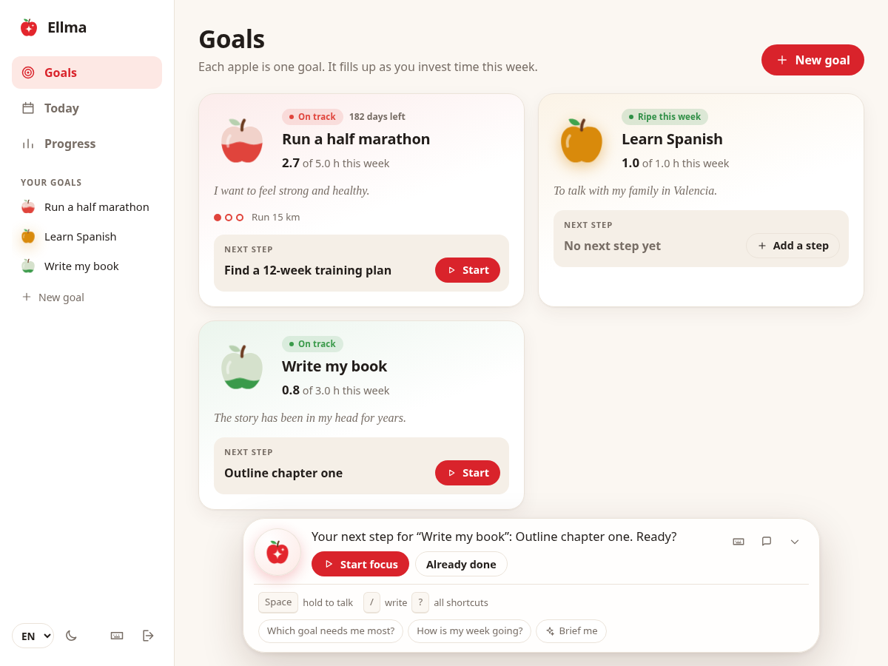

### How it works

**1. Plant a goal.** No form. Ellma asks five short questions (what, why, hours a week, a date, the first small step) and you answer by typing or by voice.

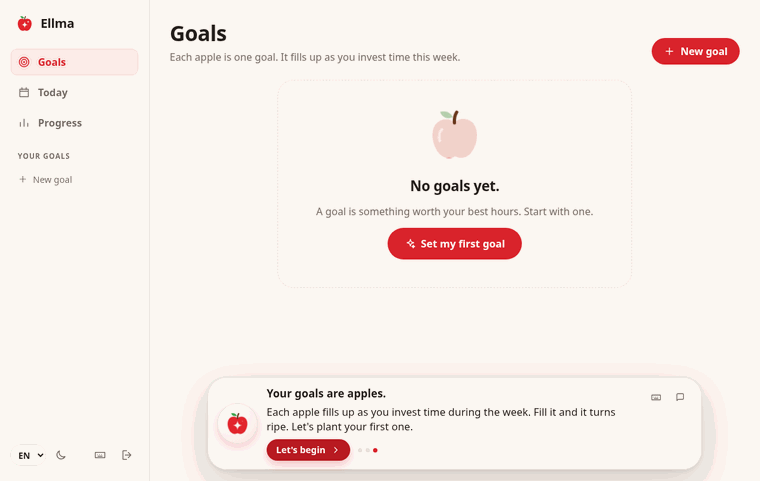

**2. Follow the next step.** Ellma always knows what is next. One click starts focus mode on that step, and she still listens there: say or write "done" and the step is finished and the time is logged.

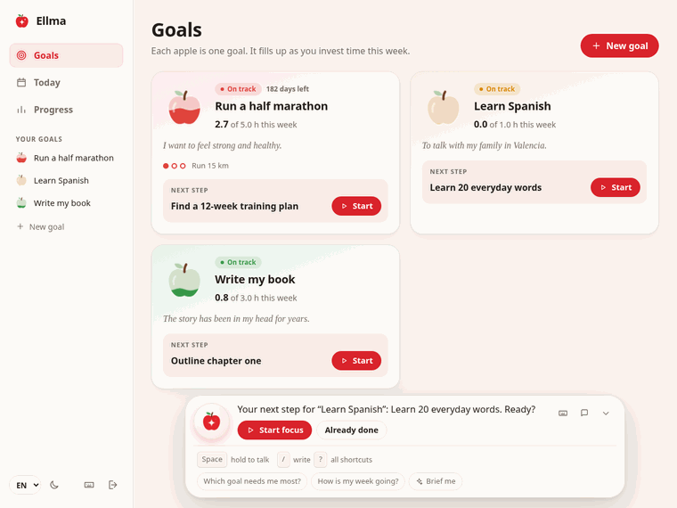

**3. Watch it ripen.** Time you invest fills the apple. When the weekly target is reached, the apple is ripe and Ellma celebrates with you.

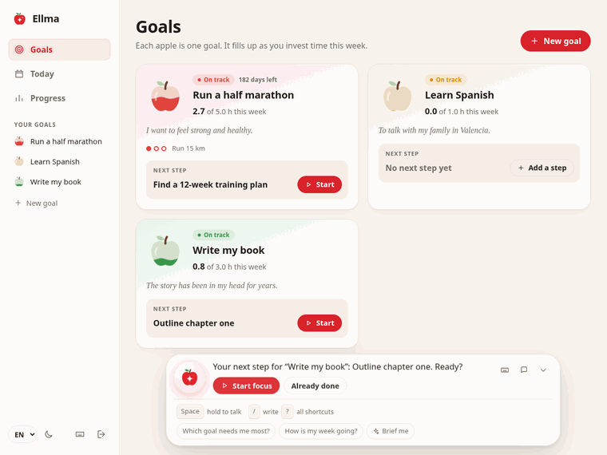

### The pages

| Today: the day sorted by goal                                                  | A goal: its week, steps and journey                                                       |
| ------------------------------------------------------------------------------ | ----------------------------------------------------------------------------------------- |
| 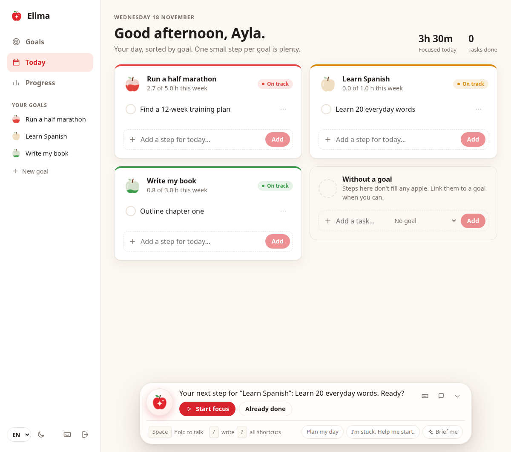 | 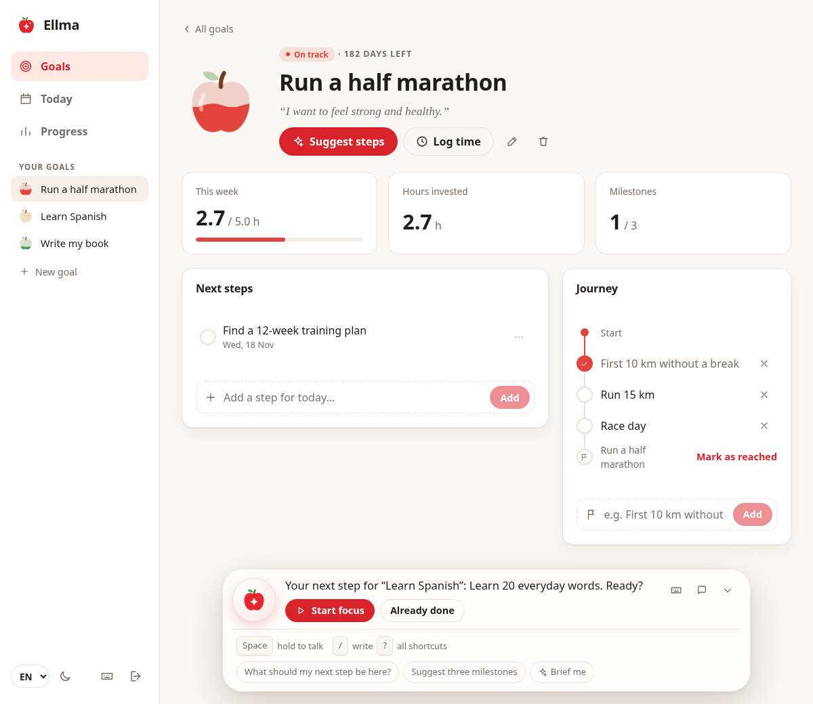 |
| **Focus: one step, one timer**                                                 | **Progress: where the hours went**                                                        |
| 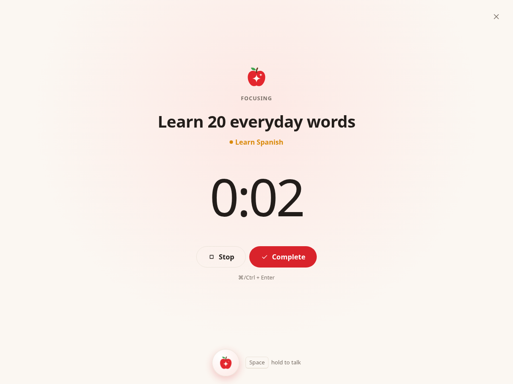                 | 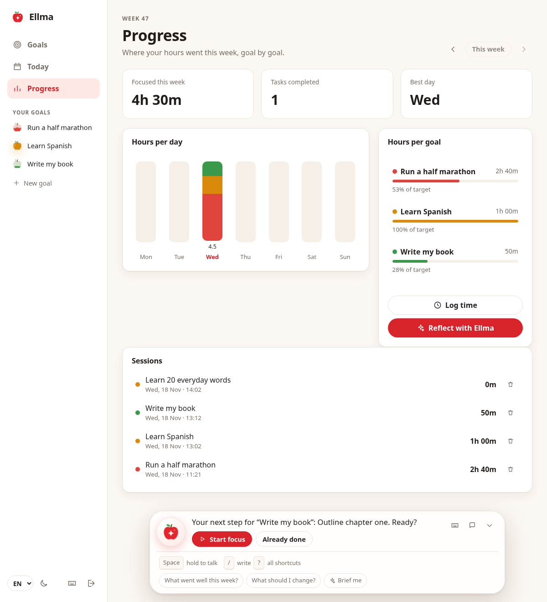               |

<p align="center">
  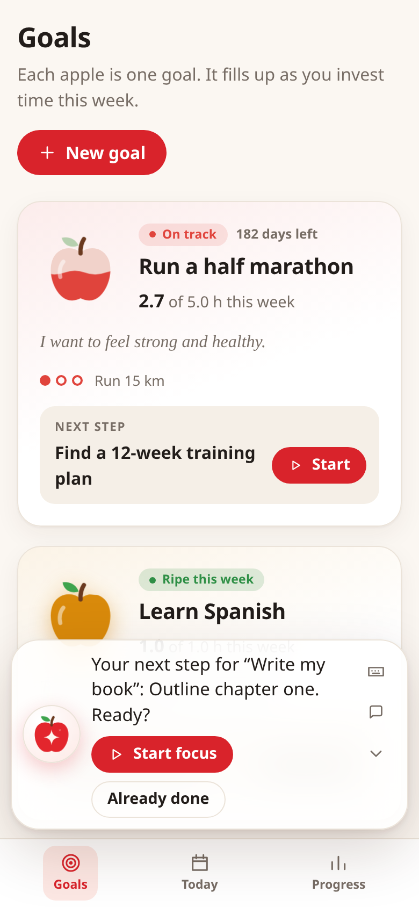
  &nbsp;&nbsp;
  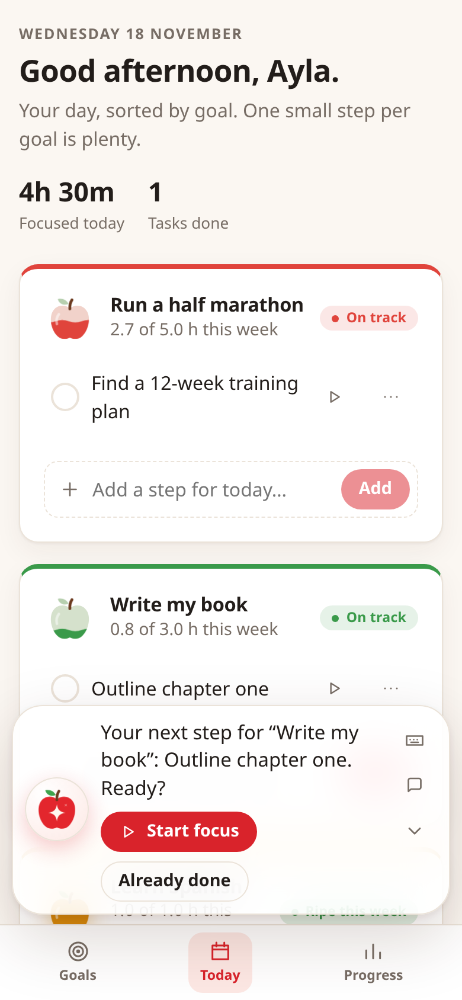
</p>

<p align="center"><em>On a phone, and in the dark:</em></p>

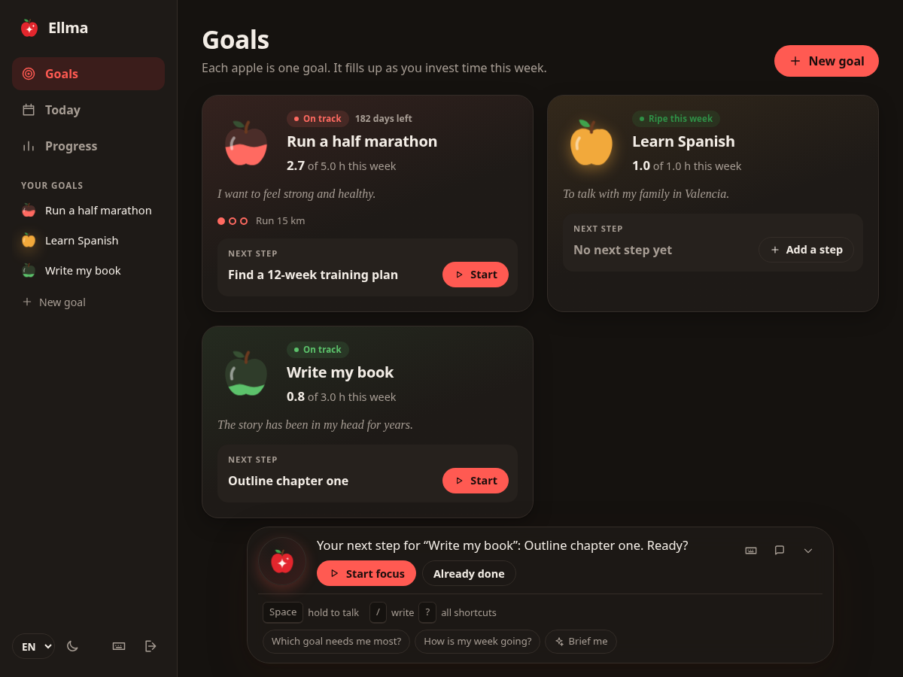

All screens were recorded from the running app with demo data. The first animation is the scripted preview from the landing page; the model itself answers more slowly on our CPU-only server (see [Notes](#notes)).

## Background

The idea is based on [Quest — Make time for what matters.](https://quest.app/): define what you want to achieve, order it by priority and invest real time in it every week. Ellma takes that idea and puts a voice-capable guide on top of it.

Ellma is also a test project. Besides being a useful app, it exists to try out two things under real conditions:

- **The yappai infrastructure**: building on [Yappio](#built-on-yappio), hosting through [Yoster](#host-with-yoster), routing via Traefik, and sharing services (`shared-mongo`, `ollama`) between apps instead of running one stack per app.
- **Open-weight models in local operation**: an assistant that runs entirely on our own hardware (Ollama + Qwen, CPU-only for now), with tool calling and streaming, and how far that gets in daily use compared to hosted models. Speed, tool reliability and prompt caching are the main questions (see [Notes](#notes)).

## What it does

| Area                  | Features                                                                                                                                                                                                                                                                                                                                                                                                                                                                            |
| --------------------- | ----------------------------------------------------------------------------------------------------------------------------------------------------------------------------------------------------------------------------------------------------------------------------------------------------------------------------------------------------------------------------------------------------------------------------------------------------------------------------------- |
| **Ellma, everywhere** | No chat page: a guide bar on every page (also in focus mode). Hold `Space` and talk, or press `/` to write. She always shows the next best step with one button to do it, knows which goal is on screen, answers by voice, and acts through tools (goals, steps, time, focus, milestones). Short commands such as "show my progress" or "done" run instantly without the model.                                                                                                     |
| **Guidance**          | Decided instantly from your data: first goal, carried-over steps, today's step for the goal that needs it most, goals without a next step, weekly gaps, and a calm "enough for today". First-run intro and a guided, voice-capable goal setup (what, why, hours, date, first step).                                                                                                                                                                                                 |
| **Goals (home)**      | Every goal is an apple that fills as you invest time this week and turns ripe at the weekly target; each card shows the next step with a Start button. Goal page with journey (milestones), steps, hours. Goals are grouped by the day of their next planned step, carry your own tags and show their target date; the badge names the reason when one needs you ("Step overdue", "No next step"). Both Goals and Today have tag, status and sort filters that each page remembers. |
| **Today**             | Steps grouped by day: overdue, a highlighted today, and folded tomorrow, later and no date sections with counts. Start focus right on the row; move a step to today or tomorrow from its menu.                                                                                                                                                                                                                                                                                      |
| **Focus**             | Full-screen timer on one step; Ellma still listens ("done", "stop"). Calm pendulum pieces with quiet pauses play while the session runs, brighter in the morning and softer at night (mute button or `M`). Two clear endings: End focus saves the time and keeps the task open, Complete task also checks it off; afterwards the goal's apple fills by the saved time.                                                                                                              |
| **Progress**          | Hours per day (stacked by goal), per goal vs. target, sessions, manual time logging, reflect with Ellma.                                                                                                                                                                                                                                                                                                                                                                            |
| **Everywhere**        | Animated page changes, celebrations for finished steps, milestones and ripe weeks, EN/DE, light/dark, mobile layout, keyboard shortcuts (`?`), local cache for instant start. Quiet sounds for main actions and a rare, kind reminder (sound and tab title) when a step is waiting and the tab has been left for 20 minutes; all switchable under Account.                                                                                                                          |

### Accounts, security and the admin panel

- **Sign-in** goes through Ellma's own endpoint (`/api/ellma/account/login`), which limits attempts and asks for the second factor when the account has one.
- **Account page** (`/account`, the person icon in the sidebar; "Account" in the phone bar): change the password (signs every other device out) and switch **two-factor sign-in** on or off. Two-factor uses any authenticator app (TOTP) via QR code, plus eight one-time backup codes that are shown once.
- **Password recovery**: "Forgot your password?" sends a one-time link that works for 30 minutes. It needs the `MAIL_*` settings in `.env`; without them the page says that reset by email is not available. A reset keeps two-factor sign-in on.
- **Admin panel**: a separate site (`admin/`, container `ellma-admin`, `https://ellma-admin.yappai.de`) for accounts with the `admin` or `root` role. It shows totals and the list of accounts, never goals, steps or conversations. Admins can grant or remove admin rights, switch off someone's two-factor sign-in, send a reset email and delete an account with all its data. Admins manage users; only root manages other admins.

The first administrator is created by Yappio at first start. Sign in with the name `admin` (not an email address) and `INITIAL_ADMIN_PASS` from `.env`.

What is stored for this: the authenticator key encrypted, backup codes and reset links only as keyed fingerprints (`EllmaAccountSecurity`). This collection is closed to Yappio's generic API, also for admins.

### Legal pages and footer

Every public page (and the app's sidebar) has a footer with **Data privacy**, **Terms and conditions**, **Cookie settings**, **Imprint** and a "Powered by yappai" link. The texts live in `shared/src/locales` (`legal`) in English and German and describe what Ellma actually does; have them reviewed before opening Ellma to the public.

- **Imprint**: the operator comes from `VITE_LEGAL_*` in `.env` (see `.env.example`) and is built into the web app. Until name, address and email are set, the imprint says the details are missing.
- **Cookie settings**: Ellma sets no cookies and has no tracking. The dialog shows what is kept in the browser's local storage and lets people switch off the local copy of their goals (`web/src/lib/consent.ts`).

### Keyboard shortcuts

hold `Space` talk (anywhere) · `⌘/Ctrl J` listen on/off · `/` write to Ellma · `1–3` pages · `N` task · `G` guided new goal · `L` log time · `J/K` select task · `X` done · `E` edit · `P` focus on task · `F` focus mode · `⌘/Ctrl ↵` complete in focus · `S` stop focus · `M` focus sound on/off · `V` read aloud · `D` theme · `Esc` stop Ellma / close · `?` overview

## Built on Yappio

**Yappio** is yappai's own backend framework for Node.js. It bundles the parts every app needs, so a new app only has to write its domain logic. It is distributed as private npm packages from our Verdaccio registry:

| Package         | Purpose                                                                                                |
| --------------- | ------------------------------------------------------------------------------------------------------ |
| `yappio`        | The server. Starts an Express app with security and compression middleware and connects to MongoDB.    |
| `yappio-client` | Browser/Node client: sign-in, session and token storage, REST calls and an optional socket connection. |
| `yappio-ui`     | React components (MUI-based inputs such as media and PIN). Not used by Ellma.                          |

What Yappio provides out of the box:

- **Authentication**: registration and login with hashed passwords and JWT tokens, profiles with roles, an initial admin account, optional OTP.
- **Collections**: data models declared in a few lines (`createCollection("EllmaGoal").withSchema({ ... })` with `Provider` field types), backed by Mongoose, plus a generic REST API for them.
- **Platform**: app metadata (`appId`, version, environment), a health endpoint (`/yappio/health`) and admin/root access.
- **Realtime**: optional WebSocket channels via socket.io.

How Ellma uses it: Yappio handles accounts, sessions and storage. Ellma adds its own routes under `/api/ellma` (goals, tasks, focus, assistant, account, admin) on top of the Yappio server and puts a boundary in front of Yappio's generic management API, so only admins can reach it and users only ever see their own records. Yappio's own password-reset, mail-code and authenticator routes are closed at that boundary because Ellma replaces them (see [Accounts, security and the admin panel](#accounts-security-and-the-admin-panel)). WebSockets are turned off; the assistant stream is plain server-sent events because Yappio's REST engine cannot stream.

## Stack

- **Yappio** (`yappio@1.3.1`, `yappio-client@1.0.1` from Verdaccio): auth (register/login), collections, platform/health and admin.
- **Server**: Express via Yappio, Mongoose collections `EllmaGoal`, `EllmaTask`, `EllmaFocusSession`, `EllmaAssistantMessage`, `EllmaDailyNote`, `EllmaAccountSecurity` on `shared-mongo` / database `ellma`.
- **Model**: Ollama `qwen3.5:4b` (configurable `OLLAMA_MODEL`) with tool calling, streamed to the browser as server-sent events.
- **Voice**: the browser's Web Speech API (recognition and synthesis). In Chrome, recognition audio goes to the browser vendor's speech service; see _Notes_.
- **Admin**: a second small React + Vite app (`admin/`) on its own host; it talks to the same API.
- **Web**: React 18 + Vite, no UI framework (`yappio-ui` only offers MUI media/PIN inputs, which Ellma doesn't need).

## Develop

```bash
npm install --registry http://192.168.178.131:4873/
cp .env.example .env            # or: npm run setup:environment
npm run dev                      # API :4000 + web :5180 + admin :5181
```

For local work, `ALLOWED_ORIGINS` in `.env` must include the web and the admin dev origins (see `.env.example`).

## Verify

```bash
npm run check && npm test && npm run build
npm run test:database                    # isolated throwaway DB on shared-mongo
ASSISTANT_TEST=1 npm run test:database   # + live model round trip (slow on CPU)
npm run verify:infrastructure            # compose, routes, Yoster manifest discovery
```

## Host with Yoster

**Yoster** (repository `yappai-host`) is yappai's hosting manager for our own server. Instead of every app bringing its own database, proxy and model server, apps live side by side in one hosting root and share one set of infrastructure. Yoster finds the apps, knows what they need, and starts and stops their Docker Compose stacks.

How it fits together:

- **Discovery by manifest**: each app has a `yappai.host.yaml` in its root. Yoster scans the hosting root for these manifests and registers every app it finds. The manifest names the app, its services and container names, the Compose env file, and the database it needs, referenced by connection (here `ellma` on `shared-mongo`).
- **Shared infrastructure** (in `infra/` of the hosting root):
  - `shared-mongo`: one MongoDB for all apps, with one logical database and one user per app.
  - `ollama`: one model server that all apps share.
  - Traefik on the external `dev-proxy` Docker network: routes domains to containers via dynamic config files (`infra/traefik/dynamic/`), not Docker labels.
  - A Cloudflare tunnel makes the `*.yappai.de` domains reachable from outside.
- **Apps stay plain Compose projects**: Ellma only declares its three containers (`ellma-web`, `ellma-admin`, `ellma-api`) and joins `dev-proxy`. Everything else comes from the shared infrastructure. That is why it can also be started by hand with `docker compose`.

`npm run verify:infrastructure` runs Yoster's own discovery code against the manifest, so a broken manifest shows up before deployment.

Steps:

1. `npm run setup:environment`: creates the `ellma` DB user on shared-mongo, writes `.env` (0600) with generated secrets, and installs `infra/traefik/dynamic/ellma.yml`.
2. Point DNS / the Cloudflare tunnel at `ellma.yappai.de`, `ellma-admin.yappai.de` and `ellma-api.yappai.de` (change the domains in `docker/traefik.yml`, `yappai.host.yaml` and `.env` if needed).
3. For password reset by email, set `MAIL_HOST`, `MAIL_PORT`, `MAIL_USER`, `MAIL_PASS` and `MAIL_SENDER` in `.env` (SMTP over TLS, usually port 465).
4. `npm run verify:infrastructure`, then start **Ellma** from Yoster (or `docker compose --env-file .env -f docker/docker-compose.yml up -d --build`).

## Notes

- **Speed**: on this CPU-only host, `qwen3.5:4b` answers in roughly 10–60 s depending on tool rounds; replies stream so text and voice start early. A GPU or a smaller model (`qwen3:1.7b`) makes it much faster.
- **One reply at a time per user**; a second simultaneous request gets `assistant_busy`.
- **Fully local voice** would need a self-hosted speech-to-text (e.g. Whisper) container; the API is ready to accept text from any source.
- Open registration is enabled (`/authenticate/register` creates `user` profiles). Sign-in, code and reset attempts are limited in the API (in memory, per address and per account); registration is not, so consider rate limiting at Traefik before going public.
- **An admin with two-factor sign-in** can only sign in through Ellma's own login. Tools that log in through Yappio's `/authenticate` directly get no usable token for that account.
